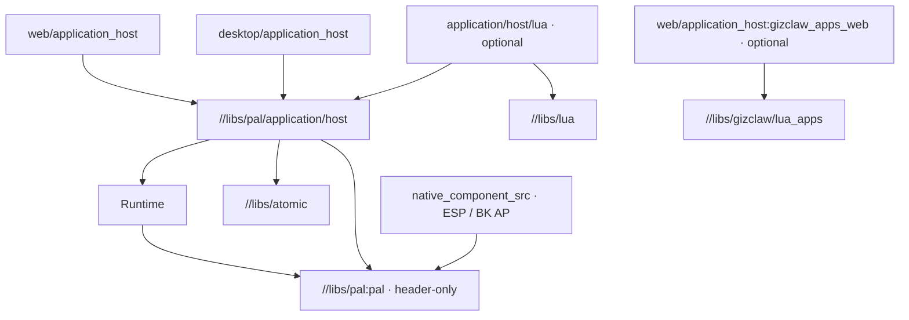

# Application Host

Application Host 是 PAL application 的宿主合同和公共组装层。它让 Web、Desktop、ESP 与 BK 注入平台差异，并共享 prepare、Runtime 初始化、required-component 校验、App task、协作停止、退出等待、检查销毁与平台释放。App 仍只消费 Runtime；产品 mapping、H2Loader、catalog 和 board selection 由调用方注入。公开参数与 ownership 以 [Public API](/references/application-host) 的生产头文件为准。

## 依赖与 ownership

下面箭头表示依赖。基础 PAL target 只包含合同头文件；Application Host 不进入 Runtime 的依赖闭包。



`h2/pal/application/h2_pal_application_host.h` 只依赖 PAL 公共错误码，通过 opaque Runtime struct pointer 表达组装参数，不 include Runtime、SDL、Emscripten、SDK 或 board header。分类目录仍属于基础 PAL package；共享实现是单独的 Bazel package。Runtime 不新增 Host field，也不持有 Host。

`libs/app_host/**` 的源文件、头文件、构建宏、shell、测试及公开 API 保持原样，继续独立可用。原 `libs/lua/web` 也保留旧 Web 生成路径。新 Web provider 使用独立的 C board 类型与 symbol，仅复用旧 board 的公开 Starlark descriptor identity，使既有 board target 可以被两个 helper 消费；新路径的 Runtime/App 生命周期不依赖旧 Host library。

## 共享生命周期

1. 调用方用独立 allocator 创建 single-use Host。API descriptor 被复制，opaque context、字符串和 provider 依赖仍借用。
2. 平台在调用线程 prepare，并提供完整 Runtime config。prepare 失败也进入平台 release 回滚。
3. 公共 control task 调用产品 configure、初始化 Runtime、validate required components，再 activate 外部输入。configure 失败仍调用配对的 release_runtime；部分 activate 失败仍执行 deactivate。
4. 公共 App task 执行 entry。调用线程持续 poll 平台事件；窗口关闭、页面 Stop 或 run_ms 只设置协作停止标记。App 在返回前自行停止并 join 自建 worker。Lua runner 用 cancel job 与 checked Host destroy 完成这一责任。
5. 公共流程成功 join App，deactivate 并 drain 外部 callback，然后调用 `h2_runtime_destroy(&runtime)`。Runtime 指针仍非 NULL 时保留依赖图；指针为 NULL 的 latched worker fault 仍报告失败，但允许继续安全释放。
6. 产品 release_runtime 后，调用线程成功 join control task，最后释放平台资源。Web 在 UI 上撤下 singleton 并 drain 同步 UI callback 后，才释放公共 Host descriptor。

Web 先启动 Runtime input consumer，再绑定 DOM producer。shell 的 physical sources 与待投递 edge 队列分离：TIMEOUT/BUSY/WOULD_BLOCK/FULL 表示该 edge 未接纳，最多 256 个待投递 edge 按全局 FIFO 重试，release 和后续 press 不互相越过。UI 每批最多处理 32 个 edge，以 timer 让出浏览器事件循环；Runtime 仍在接纳时赋予 timestamp。blur/隐藏/解绑将最后的 release 入队，解绑立即关闭 DOM admission，并返回 Promise 等待队列排空和 retry timer 取消，公共 control task 成功等待后才能销毁 Runtime。拒收会触发 pump Worker 上的 input health 检查，永久故障的 consumer 用 CLOSED 关闭 UI 重试并请求停止；健康检查不能在 UI 上取得阻塞 PAL mutex，其 Runtime borrow 也必须在销毁前排空。终止错误或 outbox 溢出关闭 admission、取消重试并请求协作停止，Host 最终报告 FAIL；retained Host 的 UI 注入返回 CLOSED，不能作为 BUSY 永久重试。旧 `libs/app_host` 保持原实现。

App 普通错误与清理失败是不同结果。结果的 application/cleanup 保存实际错误，retained 表示无法证明释放安全。任何 uncertain join、输入解绑、Runtime destroy 或 provider release 失败都禁止报告成功；retained Host 不提供自动恢复或重新运行。可以在 App 内重试 contract 明确允许的 bridge close；最终仍失败时调用 retain，保留 persistent owner 和全部依赖。重复 run 也保留原 retention 证据。

协作停止没有强制取消或退出 deadline；不响应停止的 App 可以继续占用资源，同时平台事件循环仍推进。无法 join 的 task、失败的 Lua display transport、打开的 filesystem handle 都不能靠取消外层 entry 证明安全。allocator 必须独立于 provider release，并覆盖 Host destroy；上下文不能使用在 retained 返回后失效的栈对象。

## Web 最小入口

```c
#include "h2_web_application_host.h"

static h2_pal_result_t entry(h2_application_host_t *host,
    h2_runtime_t *runtime, void *user) {
    (void)user;
    h2_pal_result_t rc = h2_application_host_ready(host);
    while (rc == H2_PAL_OK && !h2_application_host_should_stop(host))
        rc = h2_pal_time_sleep_ms(runtime->time, 10u);
    return rc;
}

int main(void) {
    const h2_web_application_host_config_t config = {.name = "demo"};
    return h2_web_application_host_run(&config, entry, NULL);
}
```

```starlark
load("@gizos//libs/pal/providers/web/application_host:web_app.bzl", "h2_web_app")

h2_web_app(name = "demo", srcs = ["main.c"], app_name = "demo", deps = [])
```

该宏保留 wasm tar、serve、browser_test、COOP/COEP headers、preload、board skin、按键与 canvas test 接口。C main 和 PAL task 在 pthread Worker 运行，DOM、持久化、Canvas 与 Promise 调用通过 Web main-thread proxy。persistent_root 使用实际 IndexedDB，readonly_roots 保留资产隔离，LVGL 是可选 provider 资源。hardware 提供 prepare/release_prepare、configure/release_runtime、validate_runtime 和 Button producer；required-component 检查应在 validate_runtime 中完成。

## 四端注入

| 平台 | Provider 与调用上下文 | 调用方注入 |
| --- | --- | --- |
| Web | `//libs/pal/providers/web/application_host`；C main Worker，UI proxy | hardware、persistent/readonly roots、board/skin、App entry |
| Desktop | `//libs/pal/providers/desktop/application_host`；进程主线程 run | 完整 Runtime config、SDL window config、event callback；其它 provider 与产品资源由调用方拥有 |
| ESP | `//native_component_src/esp-idf6.x/h2_application_host`；已有 SDK/BSP task | 同一个 PAL `user + const vtable`，提供 prepare/activate/poll/deactivate/release/notify；由目标配置 PAL task policy |
| BK | `//native_component_src/bk7258/ap/h2_application_host`；AP BSP entry task | 同上；CP 不链接 Host/Runtime，Armino yield 由 AP provider 执行 |

Desktop 的 App/Runtime 在公共 control/App task 上运行，SDL 事件与实际 renderer 由主线程推进。Display open/reopen 经 provider 的同步请求代理回主线程；其它 SDL PAL 操作借用内存并由既有 provider 锁和 deferred rendering 处理。provider create、run、destroy 都检查进程主线程；不把第三方 SDK type 泄漏到基础 PAL。

ESP/BK 直接接收 `h2_pal_application_host_api_t`，使用与 Web/Desktop 相同的 PAL vtable，不另设 SDK config 或另一套回调名称。所有 slot 必须提供；没有外部输入时 activate/deactivate 显式返回 OK，没有额外停止来源时 poll 写入 0 并返回 OK。provider 只包装 SDK task identity 检查与 scheduler yield，header 和 native component 仅依赖基础 PAL 合同，不依赖共享 Host 或 Runtime。prepare/poll/release 必须回到 init 时的已有 task，并拒绝 ISR；prepare 返回实际 BSP Runtime config，release 必须容忍部分初始化，activate/deactivate 负责外部输入接入与 drain。API descriptor 被复制，vtable 与 user context 保持借用直到成功清理，retained 时继续保持有效。provider 不选择私有 board。`$application/control` 与 `$application/entry` 的 placement、priority、stack region 由最终 target task policy 提供，config 中可分别设置 control/App minimum stack。参考新增 `projects/e2e/targets/h2loader_tar_zlib/application-host/{devkit,bk7258_v3_202405}` 的实际 main 和构建接线。BSP wrapper 会在 entry 返回后释放 provider 时，retained 路径必须保留 owner task/context，不能返回触发自动清理。

通用接线是创建平台 provider，将其 API 填入 `h2_application_host_config_t.provider`，调用 create/run，再按 result.retained 决定能否 destroy descriptor 和调用方持有的 provider。config 表达 App entry、allocator、运行时限和 task stack 等实例参数；其中 configure/validate/release_runtime 只负责产品资源，平台生命周期只使用 PAL vtable。平台 release 只释放平台拥有的资源。H2Loader confirm/return、网络恢复和产品目录由调用方配置。

## Lua 与 catalog

`//libs/pal/application/host/lua` 提供可选的 portable Lua runner，四端都可以在 entry 中调用 `h2_application_host_lua_run(host, runtime, &config)`。它接收 ordinary Lua Host budgets、persistent resources、job args、module registration 与 event routing；填入同一个 Runtime，运行一个 job，首次等待时 ready，Host stop 时 cancel，最后 checked destroy Lua。module/resource context 在 retention 时必须保持有效。

`//libs/pal/providers/web/application_host/lua:lua_web_app.bzl` 的 `h2_lua_web_app()` 生成 board Button args、脚本资源与事件映射，执行交给共享 Lua runner。它保留 script args、memory/source budgets、exit Button、extension、serve/browser_test 和 layout 行为。

浏览器包管理使用可选 `//libs/pal/providers/web/application_host:gizclaw_apps_web`；它借用产品已有的 GizClaw catalog，提供 Promise `h2WebLuaApps.install/list/uninstall`。它不持有另一份索引，也不把包管理业务放进 PAL core 或 VM。绑定、关闭、File/Blob/typed buffer、持久化与用户 KV 边界见 [Web 应用](/apps/web#浏览器-lua-应用目录-sdk)。产品退出顺序为关闭并成功 join bridge、销毁 catalog、退出 App，然后由共享 Host 清理 Runtime/provider。

## WASM 使用点

### 手写 Web entry

- `projects/example/targets/pkg_tar/audio-system`：迁移 main、Host API 与打包宏。
- `projects/example/targets/pkg_tar/display`：迁移 main、Host API 与打包宏。
- `projects/example/targets/pkg_tar/log`：迁移 main、Host API 与打包宏。
- `projects/example/targets/pkg_tar/lua-cosmic-drift`：迁移 main、Host API 与打包宏。
- `projects/example/targets/pkg_tar/lvgl-smoke`：迁移 main、Host API 与打包宏。
- `projects/example/targets/pkg_tar/qrcode`：迁移 main、Host API 与打包宏。
- `projects/example/targets/pkg_tar/raster2d`：迁移 main、Host API 与打包宏。
- `projects/example/targets/pkg_tar/starboy`：迁移 main、Host API 与打包宏。
- `projects/example/targets/pkg_tar/tap-reset`：迁移 main、Host API 与打包宏。
- `projects/example/targets/pkg_tar/touch`：迁移 main、Host API 与打包宏。
- `projects/example/targets/pkg_tar/web-hardware`：迁移 main、Host API 与打包宏。

### Lua 生成 entry

- `projects/example/targets/pkg_tar/lua-script`：迁移生成 glue、共享 Lua runner 与打包宏。
- `projects/example/targets/pkg_tar/lua-script-config`：迁移生成 glue、共享 Lua runner 与打包宏。
- `projects/example/targets/pkg_tar/lua-script-extension`：迁移生成 glue、共享 Lua runner 与打包宏。
- `projects/example/targets/pkg_tar/lua-script-input`：迁移生成 glue、共享 Lua runner 与打包宏。
- `projects/example/targets/pkg_tar/lua-script-stop`：迁移生成 glue、共享 Lua runner 与打包宏。
- `projects/example/targets/pkg_tar/lua-script-submit`：迁移生成 glue、共享 Lua runner 与打包宏。
- `projects/example/targets/pkg_tar/lua-script-vector`：迁移生成 glue、共享 Lua runner 与打包宏。
- `projects/example/targets/pkg_tar/web-board-amoled`：迁移生成 glue、共享 Lua runner 与打包宏。
- `projects/example/targets/pkg_tar/web-board-bk7258`：迁移生成 glue、共享 Lua runner 与打包宏。
- `projects/example/targets/pkg_tar/web-board-k4b`：迁移生成 glue、共享 Lua runner 与打包宏。
- `projects/example/targets/pkg_tar/web-board-p4-lcd43`：迁移生成 glue、共享 Lua runner 与打包宏。
- `projects/example/targets/pkg_tar/web-board-szp`：迁移生成 glue、共享 Lua runner 与打包宏。

### E2E 与间接接线

- `projects/e2e/targets/pkg_tar/pal-net-tls`：手写 boundary entry 与独立 wasm binary dependency。
- `projects/example/libs/web/demo_board`：使用新 board helper，保留旧 board descriptor identity。
- 新 `web/application_host/lua/tests/lifecycle`：实际生成入口的慢 Display Stop、ordinary error、transport/display/App join failure、EXIT 和 filesystem BUSY。
- 新 `web/application_host/lua/tests/progress`：持续渲染与 timer warmup 后，20 次按下/释放均须由 Lua 确认；每次释放后须继续输出至少三次周期进度，覆盖 retained 相同帧与最终 Stop 清理。
- 新 `web/application_host/tests/input_backpressure`：consumer 暂停握手后填满真实 16 项 Runtime raw-edge queue，观察到拒收才恢复消费；72 次 30 ms 正反向按键与图像复原、TIMEOUT/BUSY 拒收、release 保序、pointer/key 合并与 blur、异步解绑排空、部分 bind 回滚、永久故障 consumer、溢出/终止错误和 retained CLOSED；清理完成后不再有 native 输入调用。
- 新 `web/application_host/tests/gizclaw_apps`：同一 origin 的安装、卸载、刷新、无效包/hash、并发 BUSY、Stop 中断安装、独立用户 KV 与失败 close 重试。
- 旧 `libs/app_host` 和 `libs/lua/web` 的兼容测试继续使用原实现；mobile、现有 Desktop/ESP/BK 产品 entry 不迁移。

## 验证入口

```sh
bazel test --config=macos_arm64 //libs/pal/application/host/... //libs/pal/providers/desktop/application_host/...
bazel test --config=macos_arm64 //libs/pal/providers/web/application_host/... //projects/example/targets/pkg_tar/...
bazel test --config=macos_arm64 //libs/gizclaw/lua_apps/... //libs/gizclaw:h2_gizclaw_service_test
bazel build --config=esp32s3 //projects/e2e/targets/h2loader_tar_zlib/application-host/devkit:package
bazel build --config=bk7258 //projects/e2e/targets/h2loader_tar_zlib/application-host/bk7258_v3_202405:package
bazel build --config=macos_arm64 //...
bazel test --config=macos_arm64 //...
bazel mod deps --lockfile_mode=error
git diff --check
git diff --exit-code origin/main -- libs/app_host
```

固件 package 验证包括真实 SDK 编译与最终链接；query/cquery 只证明 graph。没有运行物理设备时不声明 SDK task 调度、硬件行为或设备清理已通过。Bazel disk cache 保持启用；SDK checkout 必须匹配仓库 pin 且无 tracked modification，不能清理其它任务的 SDK 改动来满足检查。
