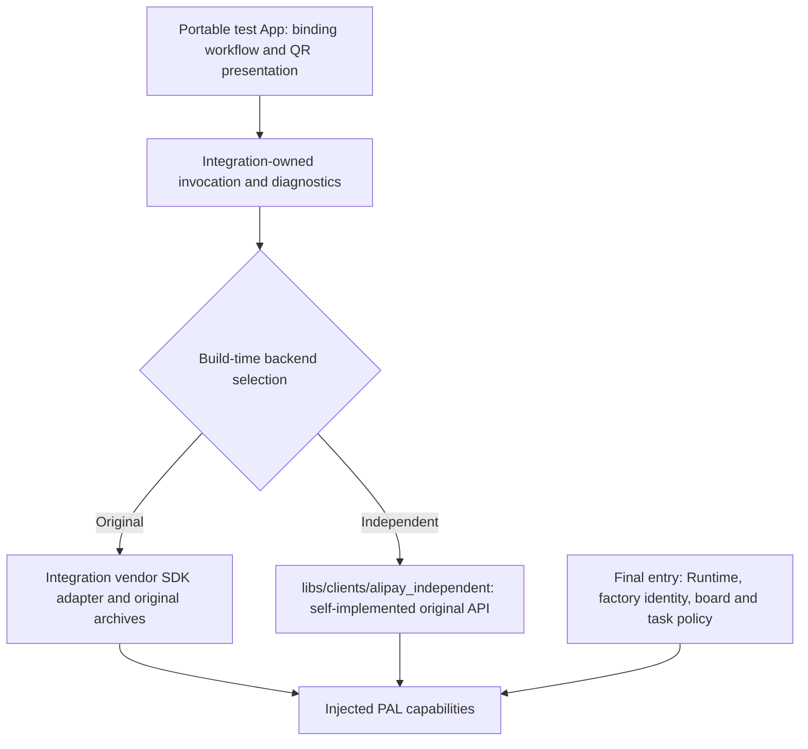

# Alipay integration test

This suite owns SDK invocation, backend selection, diagnostic capture, binding qualification and the [payment test plan](payment_test_plan.md). The production [independent implementation](../../../../libs/clients/alipay_independent/README.md) owns portable self-implemented protocol and original-API entry points. It has no dependency on this project or the vendor implementation.

The original public business and device-identity headers are the API contract for both backends. [The header-only import](../../../../third_party/alipay/api_repository.bzl) verifies unchanged caller-owned files, selects the network version of `alipay_bind.h`, and imports no `.a`, sample implementation or vendor HAL. Set `ALIPAY_API_PATH` to the original `output` directory or a headers-only tree with the same paths. The vendor backend separately uses `ALIPAY_SDK_PATH` and the original binary manifest.



[Diagnostics](diagnostics/README.md) owns the test provider interface, initialization-once helper and bounded trace. [The vendor adapter](vendor_sdk/README.md) owns original SDK invocation, PSA/certificate persistence and the test's native ESP integration. [The independent adapter](independent/include/h2_alipay_e2e_independent.h) invokes the self-implemented initialization, binding-code, query and local snapshot interfaces, and adds test evidence outside the production library. QR/barcode generation and display stay in the App; factory identity, hardware providers and Runtime lifetime stay in the final entry.

## Build selection

The Tiga entry is `//projects/testing/targets/h2_loader_tar_zlib/integration/alipay/haivivi/h106_tiga_esp_v4_2`. Select one backend per executable; both export original `alipay_*` names and must not be linked together.

| Targets | Backend and purpose | Image identity |
| --- | --- | --- |
| `:package`, `:package_v2` | Original SDK; initialization and one binding-code request | `alipay-e2e` |
| `:package_sdk`, `:package_sdk_v2` | Original SDK; full binding completion and session RAM readback | `alipay-e2e-sdk` |
| `:package_sdk_persistent` | Original SDK; explicit persistent-storage qualification | `alipay-e2e-sdk-persistent` |
| `:package_independent`, `:package_independent_v2` | Self-implemented original-API full binding and session RAM readback; no vendor archives | `alipay-e2e-independent` |

All variants share the same App, physical board `tiga_esp_v4_2`, target `esp32s3`, role `app` and version `0.1.0-e2e`. The former in-process comparison is replaced by separate builds so original global entry points have one implementation. Compare captured results and the manual protocol differential test. The independent adapter exposes query/completion and injected-store snapshot callbacks to the shared App. Both SDK and independent packages select the existing full-binding workflow (`complete_binding=true`): show the code, poll the original query entry, validate finish and storage readback, then show the result. The App's API call sites remain shared. Live account-binding equivalence requires device evidence. Payments remain outside this implementation.

With the declared ESP-IDF environment active:

```sh
export ALIPAY_SDK_PATH=/absolute/caller-owned/alipay/output
export ALIPAY_API_PATH=/absolute/caller-owned/alipay/public-headers
bazel build --config=esp32s3 --repo_env=ALIPAY_SDK_PATH \
  //projects/testing/targets/h2_loader_tar_zlib/integration/alipay/haivivi/h106_tiga_esp_v4_2:package_sdk \
  //projects/testing/targets/h2_loader_tar_zlib/integration/alipay/haivivi/h106_tiga_esp_v4_2:package_sdk_v2
bazel build --config=esp32s3 --repo_env=ALIPAY_API_PATH \
  //projects/testing/targets/h2_loader_tar_zlib/integration/alipay/haivivi/h106_tiga_esp_v4_2:package_independent \
  //projects/testing/targets/h2_loader_tar_zlib/integration/alipay/haivivi/h106_tiga_esp_v4_2:package_independent_v2
```

## Storage retention

The default Tiga entries use `storage=session`. The final entry injects a bounded [Memory Pref provider](../../../../pal/providers/backends/memory/README.md) into the SDK PSA namespace and independent context. SDK flags, TID, UID, key, seed and the matching completion record stay in RAM for the boot; closing a namespace retains committed session data, while hardware reset discards it. Original SDK headers, callbacks and record contents are unchanged. The SDK adapter checks writes, commit and readback in the selected scope; session success is not persistent-storage qualification. The page identifies session mode and reports `Bound / session readback OK`.

Before initializing a session, the final entry explicitly cleans the known historical test namespaces `alipay_psa`, `alipay_sn_psa`, `alipay_h106_psa`, `h106_pay_psa`, `alipay_direct`, `alipay_h106_ctx` and `h106_pay_ctx`, commits and verifies that they are empty, and checks that factory identity is unchanged. Unrelated Pref and all separate certificate namespaces are preserved. This cleanup precedes every session boot, with no write for an already empty namespace. After business workers join, an audit requires the persistent test namespaces to remain empty before acceptance. Cleanup/audit logs expose counts and status only.

`:package_sdk_persistent` uses the same source graph and App with an explicit storage build option. It keeps Runtime Pref, does not run session cleanup, and retains the persistent binding/readback/restart qualification path. Storage selection belongs to the final entry; portable libraries and the original ABI do not select a provider. Clearing local session state does not unbind the server or prove a fresh phone authorization.

## Binding completion

The SDK completion variant prepares network/time, initializes once and verifies cached reentry. A local snapshot reuses a verified binding, reports unverifiable existing data without resetting it, or obtains the SDK's own binding code. The UI draws the code before starting a second worker to query that same session every 2 seconds. There is no App binding deadline: an unbound pending session keeps its QR visible and continues polling beyond 60 seconds. Individual transport calls keep their finite budgets.

The supplied 60-second recommendation describes waiting policy, not a separately documented QR expiry field. Do not expire or regenerate a pending code on that timer. When the SDK returns a terminal binding failure, the App obtains one replacement code only after a local snapshot confirms UNBOUND, waits the polling interval, displays the new code and resumes polling. Unverified credentials or storage failures stop recovery without resetting data. `H2_ALIPAY_BINDING_PROGRESS` exposes periodic non-secret liveness even during an indefinite wait.

`H2_ALIPAY_BINDING_WAIT` identifies the manual phone-authorization window without printing the code. Phone authorization updates the server; the device polls `alipay_query_binding_result`, whose internal queryBindInfo path obtains TID/UID and binding material. The SDK owns ECDH processing, its PSA writes and finishBind. Success requires both the SDK completion status and committed/read-back TID, UID, shared key and seed in the selected store, followed by a matching completion record. The page removes the QR and shows only material lengths. Session mode labels this as session readback; persistent mode labels it as KV verification. H2Loader confirmation requires that full result and successful display transfer. Timeout, SDK failure or KV failure remains unconfirmed.

The continuation worker owns its result until join. LVGL, display updates and reporting stay on the UI thread. Exit stops new polls and waits for an in-flight call. Existing records are inspected locally, but this binding fixture still prepares network/time before initialization; offline-payment qualification uses a separate fixture. No variant initiates a payment, standalone unbind, reset or provisioning operation. The vendor may perform its own failed-binding cleanup.

## Identity, storage and transport

The final entry keeps H2Loader management available through the shared Device service. Both original SDK SN and IMEI callbacks return the same validated factory SN from `h106_factory/imei`; that historical key contains the factory SN. The independent configuration supplies the same text as SN and IMEI. Identity stays stable across registration, binding and later signed requests; no identity callback opens or queries the modem. Bluetooth identity remains `ESP_MAC_BT`.

Both backends use manufacturer `HAIVIVI` and raw product model `H106`; the registration form's `HAIVIVI-H106` is the combined manufacturer/model name, selected once in the final entry's `h2_alipay_tiga_identity.h`. Both backends implement the current `vendor_device_info.h` interfaces `alipay_get_companyName` and `alipay_get_productModel`. Successful output lengths exclude the terminator and buffers must include room for it. Startup reads back through these entries, so the diagnostic values come from the same configured identity as registration and signed requests. These are local identity getters, not a query of the platform's registration database. `H2_ALIPAY_PRODUCT_INFO` prints only these public fields, their return values, raw company/model comparisons with configuration, and a combined registration-name comparison with the form; it neither initializes nor gates the SDK. The protocol keeps its existing company/model composition, so the binding model is `QZ.SB.LY.HAIVIVI-H106`.

The target uses factory identity consistently for the original SDK and independent protocol. The SDK PSA namespace is `h106_pay_psa`, the certificate namespace is `h106_pay_cert`, and the independent namespace is `h106_pay_ctx`. Session mode routes PSA/context to RAM and certificates to Runtime Pref; the authorized historical-test cleanup is described above. Product fields remain `HAIVIVI`, `H106` and child-watch type 3.

The explicit public Wi-Fi fixture is `HAIVIVI-MFG` / `!haivivi`. Network/IP and UTC preparation finish before business calls. SNTP tries `pool.ntp.org`, `ntp.aliyun.com` and `time.cloudflare.com` sequentially, allowing 20 seconds per server and requiring synchronization. The gateway probe performs IPv4 DNS, bounded TCP and verified TLS to `iotapi.alipay.com:443`, then a credential-free `HEAD /mgw.htm`. A valid HTTP error status still proves reachability. Logs contain numeric stages/status, not credentials.

The binding page supports RGB565 from 240×240 to 1024×1024. Binding QR uses the supplied binding specification's error-correction H, four quiet modules and integer scaling; payer QR has a separate Q-level requirement. Host page tests inspect actual LVGL pixels at square, portrait and landscape sizes. Completed SPI DMA comparison is transport evidence, not optical screen acceptance.

## Validation

Run the owning host targets with `--config=macos_arm64`. Core tests are `//libs/clients/alipay_independent:client_test`, `:protocol_test` and `//libs/crypto/sm3:sm3_test`. Exact-header facade tests are `//libs/clients/alipay_independent:sdk_compatible_test` and `:sdk_compatible_cpp_test`; they require `ALIPAY_API_PATH` and `--repo_env=ALIPAY_API_PATH`, but no vendor archives.

Integration tests live in `:trace_test`/`:trace_cpp_test` under `diagnostics`, `:sdk_test`/`:storage_test` under `vendor_sdk`, `:socket_test` under `vendor_sdk/esp_idf`, `:workflow_test`/`:binding_workflow_test`/`:page_test` under `app`, `:collector_test` under `tools`, and the final entry's `:session_storage_test`, `:persistent_storage_test`, `:identity_test`, `:protocol_adapter_test` and `:reference_configure_test`. Vendor-header tests require the original delivery selected through `ALIPAY_SDK_PATH`.

The manual `//libs/clients/alipay_independent:sdk_differential_test` additionally takes caller-supplied `ALIPAY_XTENSA_CC` and `ALIPAY_QEMU` through `--test_env`. Controlled tests and offline machine-code comparisons do not establish a real binding or payment. Real qualification requires the correct UID/package/Stage guards, H2Loader installation, manual account authorization and actual scope-appropriate storage/ledger evidence.

## Payment menu

The original SDK package now enters an interactive payment menu after full binding and session readback. The App is confirmed only after the menu completes display verification. Its binding feature is `PAYCODE | BLEPAY | SQUARE` (`0x4009`). The independent package uses `PAYCODE | SQUARE` (`0x4001`) and now exports the original payer-code and string result-query entries through the same App flow. Its capability table omits tap payment, so that control is hidden and NFC/BLE acquisition is not started. Independent payer behavior has offline original-machine-code comparisons; real-device payment remains to be qualified.

Tiga supplies physical buttons through Runtime: Left/Right changes the focused control, OK activates it on release, and Cancel returns to the menu. The focused control uses a blue fill and outline; other controls are gray. Runtime navigation applies this style without requiring an LVGL keypad device. Numeric `H2_ALIPAY_PAYMENT_KEY` and periodic input-health logs distinguish physical acquisition, menu focus and SDK worker progress. The final entry injects four distinct logical Button component ids; the portable App contains no physical key ids. Touch is optional when these buttons are mapped. A touch-only configuration still requires a working touch provider, and real touch errors are propagated.

The payer page uses the original `alipay_get_paycode`, renders a Q-level QR, refreshes on user action and at 60 seconds, and hides an expired QR even while a network query is running. Up to three private, 120-second attempts retain their actual displayed code for result queries. Generating/drawing a code never reports a debit. Code and packet bytes are not logged or persisted. This integration keeps its display awake; product sleep/wake qualification remains separate.

Tap payment currently adapts the SDK's direct BLE broadcast branch. Runtime owns NFC acquisition; a worker reads NDEF through PAL and calls the original NFC entry. The adapter converts this delivery's 36-character service UUID to PAL binary form, preserves the SDK manufacturer payload, initializes BlueShield and honors `is_quick_pay`. A non-quick response waits for explicit confirmation and is submitted at most once. Current-attempt result queries or SDK-validated FA38 service data provide the result; an internal SDK callback or successful radio submission does not establish payment success. Radio resources are released after a terminal outcome or exit, including cleanup retry after failures.

Full NFC writeback and the older connected-BLE Notify route are not qualified by this implementation. The SDK's NFC send callback supplies application-protocol bytes, not a complete NDEF message. The generic FM175xx PAL now supports formatted, unlocked Type 2 NDEF read/write with UID checks and readback, but the delivery's Type B terminal/profile and reply-record framing still need confirmation. `FEATURE_NFCPAY` is therefore not advertised and unsupported callbacks never report success. See [the qualification plan](payment_test_plan.md) for the distinction between transport, device status and merchant-ledger evidence.
