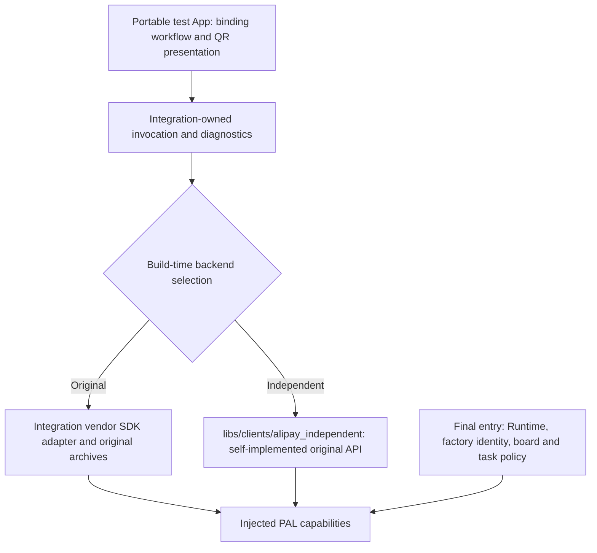

# Alipay integration test

This suite owns SDK invocation, backend selection, diagnostic capture, binding qualification and the [payment test plan](payment_test_plan.md). The production [independent implementation](../../../../libs/clients/alipay_independent/README.md) owns portable self-implemented protocol and original-API entry points. It has no dependency on this project or the vendor implementation.

The original public business headers are the API contract for both backends. [The header-only import](../../../../third_party/alipay/api_repository.bzl) verifies unchanged caller-owned files, selects the network version of `alipay_bind.h`, and imports no `.a`, sample implementation or vendor HAL. Set `ALIPAY_API_PATH` to the original `output` directory or a headers-only tree with the same paths. The vendor backend separately uses `ALIPAY_SDK_PATH` and the original binary manifest.



[Diagnostics](diagnostics/README.md) owns the test provider interface, initialization-once helper and bounded trace. [The vendor adapter](vendor_sdk/README.md) owns original SDK invocation, PSA/certificate persistence and the test's native ESP integration. [The independent adapter](independent/include/h2_alipay_e2e_independent.h) invokes the self-implemented `alipay_pre_init` and `alipay_get_binding_code`, and adds test evidence outside the production library. QR/barcode generation and display stay in the App; factory identity, hardware providers and Runtime lifetime stay in the final entry.

## Build selection

The Tiga entry is `//projects/testing/targets/h2_loader_tar_zlib/integration/alipay/haivivi/h106_tiga_esp_v4_2`. Select one backend per executable; both export original `alipay_*` names and must not be linked together.

| Targets | Backend and purpose | Image identity |
| --- | --- | --- |
| `:package`, `:package_v2` | Original SDK; initialization and one binding-code request | `alipay-e2e` |
| `:package_sdk`, `:package_sdk_v2` | Original SDK; full binding completion and verified KV | `alipay-e2e-sdk` |
| `:package_independent`, `:package_independent_v2` | Self-implemented original-API binding-code flow; no vendor archives | `alipay-e2e-independent` |

All variants share the same App, physical board `tiga_esp_v4_2`, target `esp32s3`, role `app` and version `0.1.0-e2e`. The former in-process comparison is replaced by separate builds so original global entry points have one implementation. Compare captured results and the manual protocol differential test. The independent backend currently generates binding codes; polling/completion and payments remain unimplemented and cannot qualify a bound account.

With the declared ESP-IDF environment active:

```sh
export ALIPAY_SDK_PATH=/absolute/caller-owned/alipay/output
export ALIPAY_API_PATH=/absolute/caller-owned/alipay/public-headers
bazel build --config=esp32s3 --repo_env=ALIPAY_SDK_PATH \
  //projects/testing/targets/h2_loader_tar_zlib/integration/alipay/haivivi/h106_tiga_esp_v4_2:package_sdk \
  //projects/testing/targets/h2_loader_tar_zlib/integration/alipay/haivivi/h106_tiga_esp_v4_2:package_sdk_v2
bazel build --config=esp32s3 --repo_env=ALIPAY_API_PATH \
  //projects/testing/targets/h2_loader_tar_zlib/integration/alipay/haivivi/h106_tiga_esp_v4_2:package_independent \
  //projects/testing/targets/h2_loader_tar_zlib/integration/alipay/haivivi/h106_tiga_esp_v4_2:package_independent_v2
```

## Binding completion

The SDK completion variant prepares network/time, initializes once and verifies cached reentry. A local snapshot reuses a verified binding, reports unverifiable existing data without resetting it, or obtains the SDK's own binding code. The UI draws the code before starting a second worker to query that same session. The default interval is 2 seconds and the deadline is 60 seconds between blocking SDK calls.

`H2_ALIPAY_BINDING_WAIT` identifies the manual phone-authorization window without printing the code. Phone authorization updates the server; the device polls `alipay_query_binding_result`, whose internal queryBindInfo path obtains TID/UID and binding material. The SDK owns ECDH processing, its PSA writes and finishBind. Success requires both the SDK completion status and committed/read-back TID, UID, shared key and seed, followed by a matching completion record. The page removes the QR and shows only material lengths. H2Loader confirmation requires that full result and successful display transfer. Timeout, SDK failure or KV failure remains unconfirmed.

The continuation worker owns its result until join. LVGL, display updates and reporting stay on the UI thread. Exit stops new polls and waits for an in-flight call. Existing records are inspected locally, but this binding fixture still prepares network/time before initialization; offline-payment qualification uses a separate fixture. No variant initiates a payment, standalone unbind, reset or provisioning operation. The vendor may perform its own failed-binding cleanup.

## Identity, storage and transport

The final entry keeps H2Loader management available through the shared Device service. Both original SDK SN and IMEI callbacks return the same validated factory SN from `h106_factory/imei`; that historical key contains the factory SN. The independent configuration supplies the same text as SN and IMEI. Identity stays stable across registration, binding and later signed requests; no identity callback opens or queries the modem. Bluetooth identity remains `ESP_MAC_BT`.

Original SDK PSA and certificates use `alipay_sn_psa` and `alipay_sn_cert`. Legacy `alipay_psa`/`alipay_cert` are neither copied nor reset. Independent registration uses its own `alipay_direct/context`, with a versioned device name/business identifier and identity fingerprint. Independent token and ECDH private key remain in the facade's pending in-memory session; SDK and independent sessions never mix.

The explicit public Wi-Fi fixture is `HAIVIVI-MFG` / `!haivivi`. Network/IP and UTC preparation finish before business calls. SNTP tries `pool.ntp.org`, `ntp.aliyun.com` and `time.cloudflare.com` sequentially, allowing 20 seconds per server and requiring synchronization. The gateway probe performs IPv4 DNS, bounded TCP and verified TLS to `iotapi.alipay.com:443`, then a credential-free `HEAD /mgw.htm`. A valid HTTP error status still proves reachability. Logs contain numeric stages/status, not credentials.

The binding page supports RGB565 from 240×240 to 1024×1024. Binding QR uses the supplied binding specification's error-correction H, four quiet modules and integer scaling; payer QR has a separate Q-level requirement. Host page tests inspect actual LVGL pixels at square, portrait and landscape sizes. Completed SPI DMA comparison is transport evidence, not optical screen acceptance.

## Validation

Run the owning host targets with `--config=macos_arm64`. Core tests are `//libs/clients/alipay_independent:client_test`, `:protocol_test` and `//libs/crypto/sm3:sm3_test`. Exact-header facade tests are `//libs/clients/alipay_independent:sdk_compatible_test` and `:sdk_compatible_cpp_test`; they require `ALIPAY_API_PATH` and `--repo_env=ALIPAY_API_PATH`, but no vendor archives.

Integration tests live in `:trace_test`/`:trace_cpp_test` under `diagnostics`, `:sdk_test`/`:storage_test` under `vendor_sdk`, `:socket_test` under `vendor_sdk/esp_idf`, `:workflow_test`/`:binding_workflow_test`/`:page_test` under `app`, `:collector_test` under `tools`, and the final entry's `:identity_test`, `:protocol_adapter_test` and `:reference_configure_test`. Vendor-header tests require the original delivery selected through `ALIPAY_SDK_PATH`.

The manual `//libs/clients/alipay_independent:sdk_differential_test` additionally takes caller-supplied `ALIPAY_XTENSA_CC` and `ALIPAY_QEMU` through `--test_env`. Controlled tests and offline machine-code comparisons do not establish a real binding or payment. Real qualification requires the correct UID/package/Stage guards, H2Loader installation, manual account authorization and actual durable/ledger evidence.
