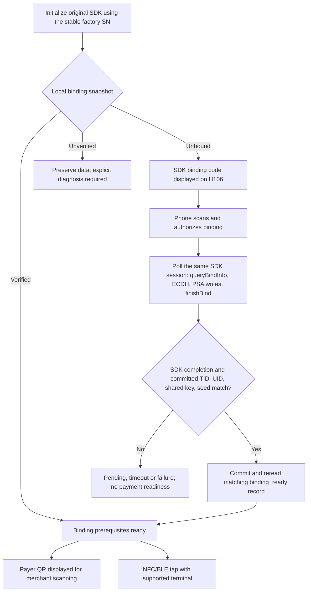
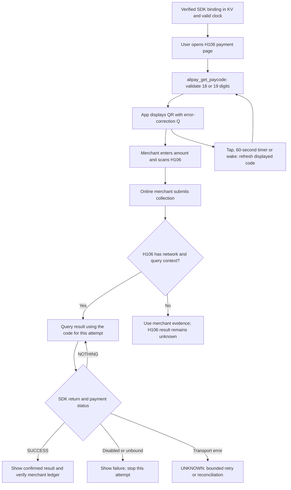
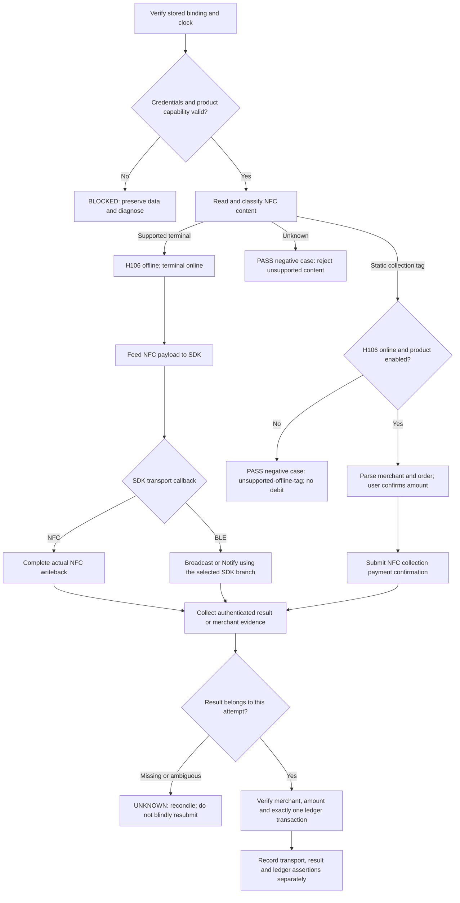

# Alipay payment test plan

This plan follows the current SDK binding implementation. H106 supports two intended payment entry points: displaying a payer QR for a merchant to scan, and NFC/BLE tap payment. H106 has no camera; scanning another party's optical QR is outside this product flow. Payment cases below are planned qualification, not completed payment tests. Public client packages own protocol interfaces and state; Apps own confirmation and presentation; PAL providers and final entries own NFC/BLE operations and physical wiring.

## Prerequisites

Require a successful SDK binding result and a later matching `binding_snapshot`, including TID, UID, shared key, seed and the completion record. Provision a dedicated approved account and merchant fixture. Select the actually enabled `FEATURE_NFCPAY` and/or `FEATURE_BLEPAY` product capabilities before qualification; the present binding fixture advertises `PAYCODE | SQUARE` only.

The payment fixture must not inherit the binding fixture's mandatory gateway probe or SNTP connection. For device-offline cases, prepare a valid clock and stored credentials beforehand, disable device Wi-Fi/PPP routing, retain UART management and record any attempted business IP I/O. The merchant terminal's network is a separate test input.

## Displayed payer QR

The original `app/pay_code/inc/alipay_pay.h` exposes `alipay_get_paycode(uint8_t *paycode, uint32_t *len_paycode)`. Supply a buffer of at least 20 bytes, check the SDK return and actual length, and accept only the documented 18 or 19 numeric characters. Encode the returned bytes as the payer QR. This is a different payload and lifecycle from the binding QR; `alipay_get_collectioncode` is a receiving-money API and is not this payer flow.

The supplied payment-interface PDF requires QR error-correction level Q, QR-first presentation, refresh on tap, refresh every 60 seconds while the payment page is visible, and refresh when waking back into that page. Preserve the specified quiet zone and integer pixel scaling from the code-format specification, and qualify optical scanning on the actual screen. Code128Auto is an optional barcode alternative, not a camera requirement.

The `pay_code` module's declared dependencies contain local security, binding state and device/time capabilities without the network module. It generates a code from the SDK's stored binding/security context and current time; H106 need not initiate a business-network request for each code. Qualify this with device routes disabled and a supported online merchant collector. Valid credentials, clock and account/product policy still apply; do not infer an unlimited offline validity window.

The merchant enters or confirms the amount on its collector and scans the H106 screen. Code generation or a successful draw does not establish a debit. H106 can query the original code's result through `alipay_query_order_result` or `alipay_query_order_result_string`; the delivered `app/pay_result/inc/alipay_pay_result.h` explicitly requires device networking for these queries. Check both the SDK return and `alipay_payment_status_e`: `SUCCESS` is payment success, `NOTHING` is pending, and disabled/unbound statuses are failures. A network error or missing result stays unknown until reconciliation.

Retain the code associated with a pending attempt across display refreshes; never substitute a newly generated code when querying that attempt. Keep codes in bounded private memory, clear them on completion/expiry/exit, and do not log or persist them as long-lived credentials. A QR displayed while H106 is offline can be scanned by the merchant, but H106 must not show a local success receipt without actual result evidence. Use merchant/ledger evidence and, where the SDK still permits the original query context, later online reconciliation. `alipay_query_flow_break` is documented only for interrupting `alipay_query_order_result`; it is not a general SDK cancellation API.

Result polling and retention have bounded lifetimes. Refreshing the visible QR does not erase an unresolved attempt or make its status belong to the new code. Leaving the page stops new work and joins any in-flight worker before buffers or SDK dependencies are released.

Source documents are the supplied `SDK说明文档/基础支付方案/支付宝智能穿戴-支付接口调用说明.pdf` and RTOS integration guide, together with the current `pay_code` and `pay_result` headers and module dependency declarations. The present SDK adapter exposes binding only; payer-code generation and payment-result adaptation are subsequent implementation work.

## Tap-payment scenario boundaries

| Scenario | Expected route |
| --- | --- |
| Supported Alipay terminal online, H106 offline | NFC/BLE terminal interaction through `nfc_offline_pay`; qualify on a real supported terminal |
| Static Alipay collection NTAG, H106 offline | Reject with callback code `NFC_PAYMENT_FAIL_ERROR_UNSUPPORT_WITHOUT_NETWORK`; no payment confirmation request |
| Static Alipay collection NTAG, H106 online | Applicable `scan_pay` parsing and confirmation, subject to product enablement and recognizable collection content |
| Arbitrary NTAG or arbitrary URL | No payment implied by physical readability; unknown content must be rejected |
| Both terminal and H106 offline | Outside the qualified target scenario; do not claim settlement support from the module's name |

An online terminal can temporarily present itself as a passive dynamic tag and refresh its data. That is distinct from a standalone static NTAG collection plate. The SDK's unsupported-offline-tag value belongs to `alipay_payment_status_t.code` delivered by the result callback; it is not a promised return value of every NFC receive function.

## Planned tap-payment flow

## Test cases

| Case | Procedure | Required evidence |
| --- | --- | --- |
| Binding durability | Complete manual phone authorization, reboot, inspect the same namespace | Completion marker and all four materials match; no new registration, rebind or finishBind on snapshot |
| Binding interruption | Inject failures at material writes, commit, completion-marker write and readback | No false COMPLETE; no repeated finishBind after SDK completion; recovery remains explicit |
| Persistent binding QR | Keep the SDK pending beyond 60 seconds, then complete authorization; separately return a terminal invalid session | QR remains visible and the same session is polled; terminal failure requests a new code only after a local UNBOUND snapshot, and the UI presents it before polling |
| Local corruption | Change/remove one material, corrupt the marker or leave bound state without a marker | NEEDS_VERIFICATION; no automatic reset or payment attempt |
| Payer QR generation | Open the payment page after verified binding; inject SDK errors, nonnumeric bytes and wrong lengths | Only a successful 18/19-digit code becomes a QR; failure clears the displayed code and exposes no secrets |
| Payer QR refresh | Tap, cross the 60-second deadline, then sleep/wake into the payment page | The correct event generates a fresh code; hidden pages stop refreshing; the previous attempt retains its own query code |
| Payer QR optics | Scan the actual H106 screen using approved merchant collectors | QR level Q, quiet zone, integer scale, contrast and brightness permit reliable scanning; SPI transfer alone is insufficient evidence |
| Payer QR, device offline | Disable H106 IP routing with credentials and clock prepared, then use an online merchant collector | Local generation makes no business IP request; merchant evidence establishes the financial result; H106 does not invent a receipt |
| Payer QR online result | Query a transaction while refreshing the displayed code; exercise SUCCESS, NOTHING, disabled, unbound and network failures | Query uses the original attempt's code; return zero alone never means paid; retries and UNKNOWN states are bounded |
| Payer QR timing and lifecycle | Use an invalid clock, expired security context, late reply, repeated scan and exit during query | No stale displayed code or stale success, no blind second charge, and every worker joins before teardown |
| Active terminal, device offline | Use a supported online terminal with H106 IP routes disabled | Actual NFC/BLE exchange; no device-side business IP dependency in the selected branch |
| Static NTAG, device offline | Read recognizable static collection content without device IP | Unsupported-offline-tag callback; no confirmation RPC and no ledger debit |
| Static NTAG, device online | Parse approved collection content, confirm merchant and permitted amount | Current parse/confirm APIs succeed and the correct merchant order is settled |
| BLE transport | Exercise direct broadcast and applicable legacy Notify branches separately; vary MTU and disconnect points | Payload/fragment order, actual send completion, confirmation timing and resource cleanup |
| Confirmation policy | Test both actual `is_quick_pay` values and supported screen/lock contexts | Required confirmation is respected; no hardcoded local small-amount bypass |
| Result parsing | Filter UUID `0000fa38-0000-1000-8000-00805f9b34fb`; feed exactly 27 bytes of serviceData to the v2 parser | Wrong length, token or account context is rejected; a valid zero real-pay amount is preserved |
| Duplicate/stale data | Repeat the same transaction frame, replay an older result, then make a distinct new purchase at the same terminal | No duplicate debit or stale success; the next genuine transaction is still accepted |
| Missing result | Lose BLE result delivery or interrupt the device after transmission | UNKNOWN/reconciliation state; no automatic second charge attempt |
| Ledger acceptance | Perform an explicitly permitted small test transaction | SDK processing, transport completion and actual financial result are distinct assertions; match account, merchant, amount and transaction count |

## SDK boundaries

Initialize `alipay_npay_ble_broadcast_init` while sufficient contiguous memory is available and register the current six-field `alipay_nfc_payment_callback_t`. Feed bright-screen and sleep/lock contexts through their corresponding NFC receive APIs. Feed terminal BLE writes through `alipay_npay_ble_recv_data_handle`, not the BLE binding receive API. Copy callback bytes before retaining them for asynchronous transport.

`notify_payment_result_handle` describes SDK processing; it is not by itself a receipt. For device-offline terminal tests, use authenticated supported BLE result delivery and merchant/collector evidence. After device network restoration, `alipay_query_last_nfc_pay_result` may provide additional evidence, but an earlier transaction must not become the current attempt's success.

For static collection tags, use `alipay_nfc_parse_with_content` and `alipay_nfc_confirm_payment` in the applicable online product flow. Preserve an order's existing amount and apply the documented confirmation process. Physical NTAG readability does not establish acceptance of arbitrary content.

Source contracts are in the caller-owned delivery under `app/nfc_offline_pay/inc/alipay_nfc_offline_pay.h`, `app/scan_pay/inc/alipay_nfc_online_pay.h` and `app/pay_result/inc/alipay_pay_result.h`. The supplied tap-payment PDF describes terminal and collection-plate flows; current headers take precedence over its older callback examples.

## Execution ownership

Offline parser and state-machine tests belong to their client/provider owners. Tests requiring a real terminal, account or Alipay service belong to this integration suite and must be explicit `manual` tests with uncached live results. Each run records the device UID, firmware/package identity, SDK manifest, selected capability mask, attempted transport, actual return/status, KV outcomes and final ledger evidence. Normal reports contain lengths and numeric diagnostics, not TID/UID values, keys, seed or binding tokens.
